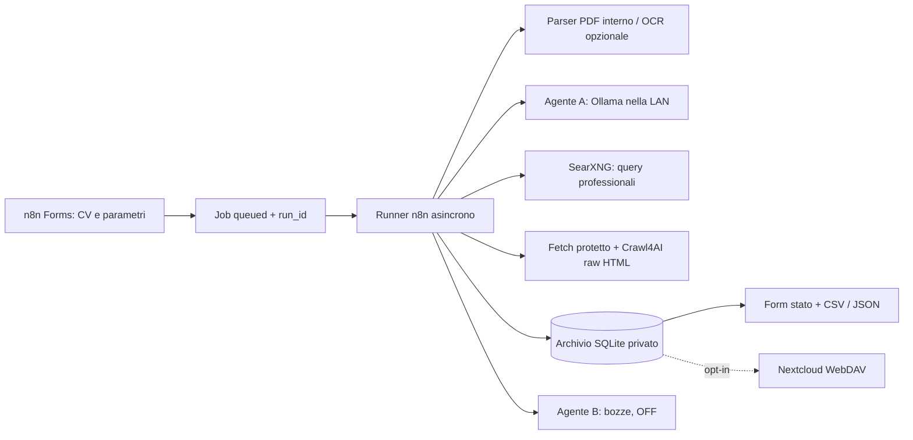

# AI Job Hunter

Ricerca personale di aziende e opportunità a partire da un **CV PDF**, con inferenza locale su **Ollama**, orchestrazione **n8n** e **n8n Forms** come interfaccia. Ogni installazione appartiene a un solo utilizzatore. Le aziende compatibili rimangono nei risultati anche senza annunci. **Non esiste alcuna funzione di invio di email o candidature.**

Il form propone Torino, 30 km e 20 aziende; i limiti sono modificabili. Dopo **Avvia ricerca**, restituisce un identificativo senza attendere l'analisi. Un secondo form consulta lo stato e scarica CSV/JSON. Nessuna dashboard separata.



## Stato verificato

Versione iniziale 0.1.0. I test locali offline coprono PDF → profilo → piano → discovery → aziende/contatti → export, due CV distinti, flag bozze, errori parziali, budget, geografia e protezioni di rete. Usano esclusivamente dati fittizi. Non dimostrano la qualità di un modello reale o la copertura delle ricerche web.

Target degli export: **n8n 2.44.4** (Form Trigger 2.6), **Crawl4AI 0.9.5**, SearXNG bloccato a commit/digest. L'importazione reale dei workflow e il contratto del crawler hanno job CI dedicati. I risultati effettivi si consultano in GitHub Actions; non si presume che un job ancora non eseguito sia passato. Il pilota LAN resta da eseguire con servizi configurati e CV autorizzato: [milestone e collaudo](docs/milestones.md).

## Avvio rapido

Servono Docker Engine/Compose su Linux e Ollama già raggiungibile sul PC della LAN. Il servizio interno Python non ha interfaccia utente; espone adattatori autenticati e archivio per i workflow. Il suo uso con SQLite, al posto dell'archivio principale nelle Data Tables, è un adattamento approvato del brief. È disponibile una proiezione opzionale dei metadati nelle Data Tables.

```sh
python3 scripts/setup.py
# Modifica .env: OLLAMA_BASE_URL=http://indirizzo-del-pc-lan:11434
docker compose -f compose.addons.yml -f compose.standalone.yml config --quiet
docker compose -f compose.addons.yml -f compose.standalone.yml up -d --build
```

Ollama sul PC: scarica il modello configurato con `ollama pull qwen3.5:4b`; se il tag non esiste nell'istanza, scegli un tag locale disponibile e aggiorna `.env`. [Hardware e configurazione LAN](docs/ollama-models-and-hardware.md).

Apri n8n sulla porta locale 5678, crea il proprietario, importa `workflows/*.json`, associa le credenziali HTTP interne e i riferimenti dei sotto-workflow, esegui `11-healthcheck`, pubblica i due workflow Forms. [Installazione completa](docs/installation-standalone.md) · [n8n esistente](docs/installation-existing-n8n.md) · [Credenziali e import](docs/configuring-n8n-and-credentials.md).

Non eseguire l'overlay standalone se hai già n8n. L'installazione addons usa volumi e rete del proprio progetto e non modifica container esistenti.

## Funzionamento e limiti

- **Agente A** estrae evidenze dal CV, sceglie query/priorità e pagine da approfondire, poi valuta compatibilità. Gli output sono validati con Pydantic e JSON Schema, con un solo tentativo correttivo.
- Le query derivate dal CV usano un [vocabolario professionale consentito](config/search-vocabulary.txt). Estendilo per professioni/tecnologie mancanti. Non contiene una lista fissa di ricerche identica per tutti i CV. Una ricerca senza termini sicuri termina con errore esplicito.
- URL scoperti: DNS pubblico, socket fissato all'IP verificato, redirect rivalidati, robots e attese; nessun login, CAPTCHA bypass o visita automatizzata di LinkedIn/Indeed. Per questi ultimi si conservano soltanto risultati indicizzati, marcati incerti.
- Crawl4AI riceve HTML ripulito in modalità raw. Pagine che richiedono JavaScript o bloccano il download possono rimanere non verificate. Nome, contatti e fatti vengono accettati solo con citazioni presenti nelle pagine lette. La verifica letterale non prova da sola che una dichiarazione aziendale sia vera.
- Distanze in **linea d'aria**, stimate dal geocoder: sedi oltre il raggio escluse; coordinate mancanti → distanza `null`, risultati secondari da confermare. Annunci e sedi possono riferirsi a luoghi diversi: verificare manualmente la località dell'offerta.
- Geocoder predefinito: **Nominatim pubblico, esclusivamente per ricerche occasionali**. Consulta la [policy d'uso](https://operations.osmfoundation.org/policies/nominatim/): massimo 1 richiesta/s, identificazione applicazione, cache e attribuzione. Nessuna ricerca periodica o sistematica. Cambia `GEOCODER_BASE_URL` per un endpoint dedicato se crescono i volumi. Dati geografici © [OpenStreetMap contributors](https://www.openstreetmap.org/copyright), ODbL.
- Annunci: `possibly_open`, `closed`, `not_found`, `unknown/error`. Questa versione non assegna `verified_open` automaticamente. Un risultato indicizzato non dimostra attualità. Le aziende senza annunci non vengono rimosse.
- **Una ricerca elaborata alla volta**, massimo 25 query totali, 6 tentativi di pagina per azienda e 30 minuti di elaborazione. Altri job attendono. Fallimenti di singole aziende producono risultati parziali. Non è implementata la cancellazione di un job in corso.
- [Stirling PDF](docs/stirling-pdf.md) e [Nextcloud](docs/nextcloud.md) sono facoltativi e OFF. [Agente B](docs/architecture-and-contracts.md) completamente implementato, `EMAIL_DRAFT_ENABLED=false`; con flag ON salva solo bozze locali da revisionare.

## Test e sviluppo

```sh
python3 -m venv .venv
. .venv/bin/activate
pip install -c requirements.lock -e '.[test]'
python -m pytest -q
python scripts/check_public_files.py
```

Windows: attiva `.venv\Scripts\Activate.ps1` oppure usa `.venv\Scripts\python.exe -m pytest -q`. Non occorrono n8n, Ollama o Internet per eseguire i test dopo aver installato le dipendenze. [Test e criteri del pilota](tests/README.md).

Il repository include workflow JSON reali, generatori riproducibili, Compose, prompt, schemi, fixture, CI e guide. [Architettura e contratti](docs/architecture-and-contracts.md) · [Privacy](docs/legal-and-privacy.md) · [Diagnostica](docs/troubleshooting.md) · [Licenze dipendenze](THIRD_PARTY.md).

Contributi: allegare una fixture sintetica, test pertinenti e fonti tecniche per modifiche agli adattatori; mai allegare CV reali, `.env`, credenziali o export personali. Codice originale sotto [MIT](LICENSE); i componenti esterni mantengono le proprie licenze.
